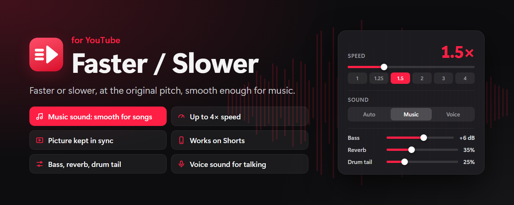
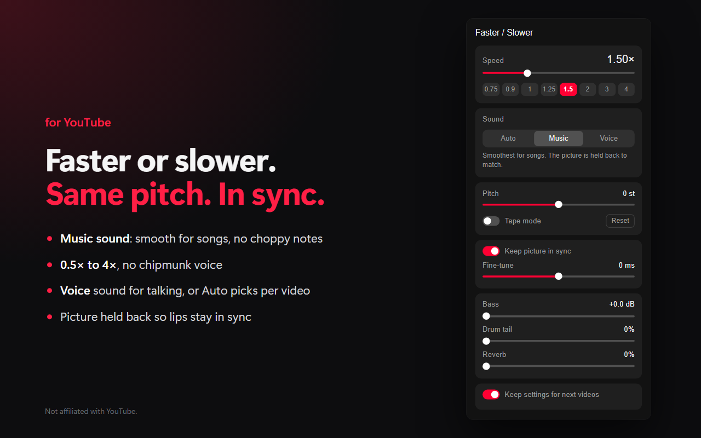
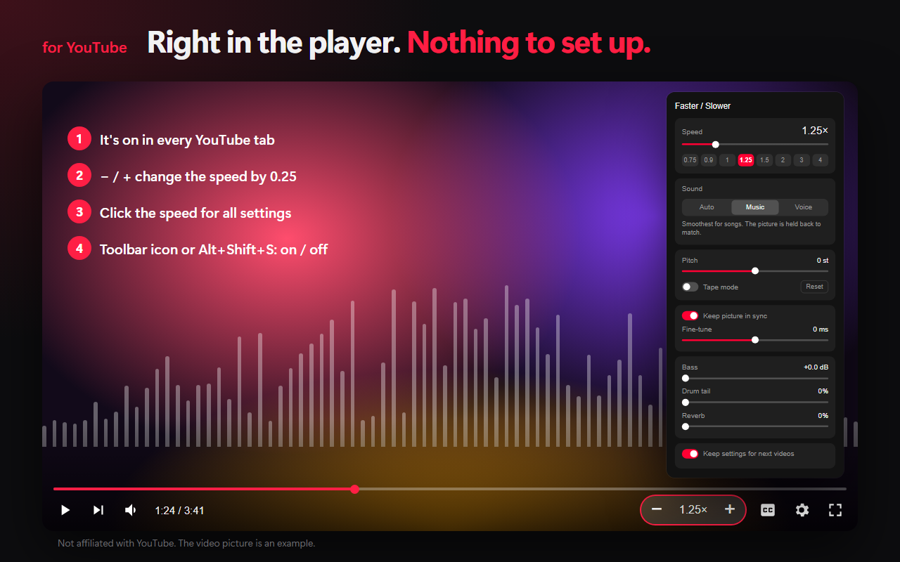
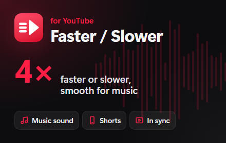

# YouTube Faster / Slower Control

(Not affiliated with or endorsed by YouTube or Google.)

Chrome extension that plays YouTube faster or slower **at the original pitch**, without the choppy sound of the built-in speed setting. Firefox version: [youtube-faster-slower-playback-speed-firefox](https://github.com/citrunade/youtube-faster-slower-playback-speed-firefox). It uses the same sound engine as its Spotify sibling, [spotify-faster-slower-playback-speed](https://github.com/citrunade/spotify-faster-slower-playback-speed): the video is sped up by plain resampling (smooth, pitch goes up) and a music-grade pitch shifter (Signalsmith Stretch) brings the pitch back down. Unlike the Spotify version, the engine runs inside the YouTube page itself (YouTube's sound isn't copy-protected, so the video can be routed straight through it): no tab capture, so every YouTube tab gets the full engine without a click.

The pitch shifter needs about 0.15 s, so the sound runs slightly behind. To keep lips in sync, the **picture is held back by the same amount**: the real video keeps playing invisibly and a canvas on top shows each frame that much later.

## Screenshots

| Speed and sound | Right in the player |
|---|---|
|  |  |

Small promo tile: 

## Install (for testing)

1. Open `chrome://extensions`, switch on **Developer mode**.
2. **Load unpacked** → pick this folder.
3. Reload any YouTube tab that was already open.

## Use

1. It is **on from the start** after installing, in every YouTube tab. **Click the extension's toolbar icon** (or press **Alt+Shift+S**) to turn it off or on — on any page; it is one switch for the whole browser and stays as set through refreshes, other tabs and restarts. While it is off, the icon shows **OFF** and nothing of the extension appears on YouTube. If the browser holds back sound until you've interacted with the page, the engine starts with your first click or key press there (usually the play button). A video paused for more than 10 s puts its tab's engine to sleep; it wakes the moment the video plays.
2. While on: **− 1.25× +** in YouTube's control bar (left of the subtitles button): − and + change the speed by 0.25 per press (0.5–4×), also in fullscreen; the speed in the middle opens all settings, just above the control bar. On Shorts the same **− 1.25× +** sits small in the bottom right corner, just above the progress bar, fades out while the mouse is off the Short, and follows you as you scroll; its settings open upward from it.
3. Pick a speed (0.5–4×). Pitch shifts by semitones; tape mode lets speed and pitch move together like a record; bass, drum tail and reverb add effects. In tape mode the pitch slider is greyed out.
4. **Sound method**: **Music** (the video plays sped up the plain way and the pitch shifter brings the pitch back; smoothest for songs, ~0.12 s delay with the picture held back to match), **Voice** (the browser's own pitch-keeping speed change, which is built for speech: clearest for talking, can sound choppy on music; the pitch shifter is skipped, so almost no delay), or **Auto** (default): Voice for clearly spoken videos (Education, News, How-to, People & Blogs categories or talk-like titles), Music for everything else. Tape mode always uses the Music method.
5. **Keep picture in sync** is on by default. If lips look early or late, use **Fine-tune** (±150 ms).
6. **Keep settings for next videos** (on by default). On: your settings carry over to every video, tab, reload and restart. Off: every video starts fresh (1×, pitch 0, tape mode off, no bass, drum tail or reverb): the next video, a video in a new tab, a reload. The sound method and picture sync stay. Settings are shared by all tabs, so a video starting in one tab also resets the others.
7. Ads play at normal speed without pitch correction; the chosen speed comes back after the ad.
8. Click the toolbar icon again (or Alt+Shift+S) to go back to normal YouTube.

## After updating the files

The browser keeps running the old background part of an unpacked extension until it is reloaded. After changing these files, click the extension's reload button on `chrome://extensions`, then reload the YouTube tab. The page shows a reminder when it notices an outdated copy.

## Limits

- Live streams can't run ahead of real time; sped-up playback there keeps catching up and stalling.
- Comments, captions and the player controls are not delayed; only the video picture is.

## Files

| File | Role |
|---|---|
| `page-rate.js` | Runs inside YouTube; forces the speed with pitch keeping off |
| `picture-delay.js` | Shows the video picture held back to match the sound |
| `content.js` | Runs the sound engine in the page (routes the videos through it, sleeps while paused); speed and picture delay; ads at normal speed; the in-player speed pill, control-bar buttons, hover labels and settings panel |
| `service-worker.js` | On/off switch, keeps every YouTube tab in step with the settings |
| `audio-chain.js`, `drum-tail-worklet.js`, `lib/` | Sound engine (shared with the Spotify version; `lib/` is Signalsmith Stretch, MIT licensed) |
| `popup.*` | Controls |
| `store/` | Chrome Web Store listing text, privacy policy, screenshots and promo tiles. `store/make-screenshots.ps1` renders the screenshots from `store/screenshots.html` (with the real settings panel, `store/panel.html`); `store/make-promo.ps1` renders the promo tiles from `store/promo.html` |
| `build-store.ps1` | Builds the zip to upload (`dist/`) |
